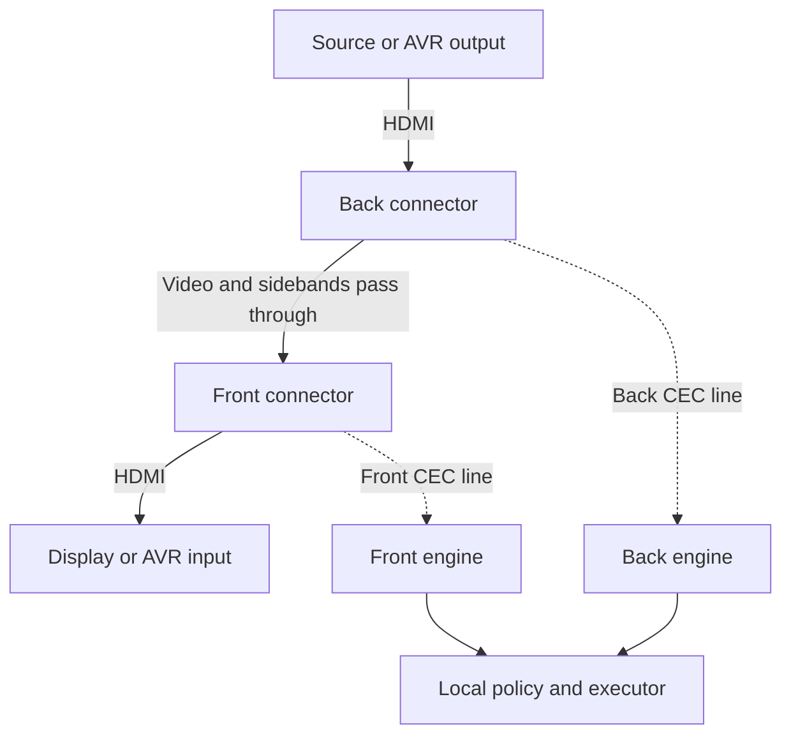

# 01 — Octopus architecture

**20 October 2026 controller-policy amendment:** [Original controller and subordinate devices](21-original-controller-policy.md) is normative. The original first-setup Amity alone hosts the UI/integrations and sole remote; added devices are UI-less actuators, never input gateways or successor controllers.

**21 October 2026 algorithm-preservation amendment:** preserve original Amity algorithms/functionality unless the user requests a change. The consortium adds ownership and transport around them; it does not authorize changed local behavior. [Normative rule](21-original-controller-policy.md#original-algorithms-and-functionality-amendment--21-october-2026).

**Status:** proposed v0.1. **Read first:** [package guide](README.md). **Contract dependencies:** [domain model](03-domain-model-and-addressing.md), [CEC runtime](04-hardware-and-cec-runtime.md), [CEC policy](06-cec-roles-and-message-policy.md).

## 1. Purpose

An octopus is one Amity ESP32 processor controlling one to five HDMI pass-throughs, called tentacles. It can operate as a complete local system or as a member of a consortium. Both modes use the same topology, policy and execution contracts. A legacy board is a one-tentacle octopus, not a separate control architecture.

[Issue 1](https://github.com/retsyx/amity/issues/1) describes three motivations: control a second display, control sources connected directly to display inputs, and prevent a source from stealing the selected input before an AVR or display reacts. These are related uses of independently isolated CEC segments; they do not require video switching inside the octopus.

The existing firmware creates one `HubService` with a front and a back bus, one selected activity, and devices found by OSD name. Its high-level hub assumes a TV/AVR arrangement. An octopus must retain the useful CEC engine and queue protections while replacing that single-system assumption. Creating five independent copies of the existing hub would produce competing activity, power and address policies. [Current composition](https://github.com/retsyx/amity-esp32/blob/d50af8026938797fc0820d0107f4c4e064c2d2bc/main/main.cpp), [hub model](https://github.com/retsyx/amity-esp32/blob/d50af8026938797fc0820d0107f4c4e064c2d2bc/components/amity_hub/include/amity/hub.hpp).

## 2. Physical model

Each tentacle contains two HDMI connectors with the ordinary HDMI signals passed through. Pin 13, CEC, is interrupted. Its **front** CEC port faces the downstream sink, such as a display or AVR input. Its **back** CEC port faces the upstream source, such as a streamer or AVR output. Each has its own GPIO and CEC state machine. Thus five tentacles require ten independently functioning CEC lines. Front and back describe cable orientation; they do not hardcode a TV or playback role.

The two CEC lines do not electrically join when firmware fails or power is removed; the current interposer has no bypass relay. No software component may emulate a generic transparent CEC bridge. A future relay or alternate hardware revision must declare a different failure behavior in its board profile. See the [existing board design](https://github.com/retsyx/amity-esp32/tree/d50af8026938797fc0820d0107f4c4e064c2d2bc/hw/board) and [hardware guide](04-hardware-and-cec-runtime.md).

The octopus cannot create an HDMI path that is absent from the cables. It cannot send a source connected only to the TV to the projector. It cannot make a receiver with one shared input selector show two independent sources. DDC/EDID, HPD, HDCP and video continue along the physical cable; CEC isolation does not synthesize or rewrite those exchanges. Full DDC proxying would be a distinct hardware/firmware project.

## 3. Software decomposition

| Module | Owns | Must not own |
|---|---|---|
| `BoardProfile` | Populated tentacle slots, safe GPIO mapping, hardware revision, button/indicator capabilities. | Portable room layout or activity state. |
| `CecRuntime` | Shared timing source, independent engines, wire access and completion events. | Network calls, configuration parsing or activity decisions. |
| `LocalCecAgent` | Port roles, local identity responses, policy snapshots, command admission and held-key watchdogs. | Autonomous competing theater policy while grouped. |
| `DiscoveryService` | Bounded scans, observations, qualified OSD-name resolution and per-port physical-address evidence. | Ambiguous/cross-attachment component substitution or unsolicited route restoration. Ordinary unambiguous LA re-resolution is automatic. |
| `GroupService` | Membership-aware request routing, local/member connectivity and snapshots. | Timing-sensitive CEC bit handling. |
| `SystemControl` | Stable ingress API for activities, power, keys, scans and administration. | Dependence on a particular remote or external integration. |
| `Coordinator` | Topology, plans, resource ownership and desired state, when this octopus has that role. | Direct GPIO access or assumptions that acknowledgement proves picture/audio. |
| `RadioArbiter` | Matter induction, consortium enrollment and remote-pairing scheduling. | Separate competing NimBLE instances. |

These names describe logical responsibilities. Agents may choose files and class boundaries that suit the repository, but these ownership boundaries must remain testable. Avoid introducing a task for every class. Use bounded queues between independent latency domains and immutable snapshots for readers.

The local coordinator path uses an in-process implementation of the same command and acknowledgement contract as remote members. It must pass the same generation, ownership and binding checks; it must not bypass policy simply because sender and actuator share a processor.

## 4. CEC execution and resource budget

The present bus creates a GPTimer per CEC line. ESP32-S3 has four general-purpose timers, so ten independent instances cannot be created unchanged. The proposed runtime uses one shared 50-microsecond timer with a fixed array of up to ten independent engines. The timer handler samples input, advances engines and releases/drives only the owned open-drain outputs; noncritical work happens outside the interrupt. This is an implementation candidate requiring worst-case measurements, not a proven capacity claim. [Current bus](https://github.com/retsyx/amity-esp32/blob/d50af8026938797fc0820d0107f4c4e064c2d2bc/components/cec/bus.cpp), [ESP32-S3 datasheet, timers](https://www.espressif.com/sites/default/files/documentation/esp32-s3_datasheet_en.pdf).

One busy or stuck CEC wire must not stop the other nine. A shared dispatcher must track independent in-flight operations rather than invoke the existing blocking transmit function serially for every port. Preserve bounded RX draining, emergency key release, retry bounds and safe line release on timing failure. See [runtime contracts and qualification](04-hardware-and-cec-runtime.md).

A `BoardProfile` is validated before enabling any output. The five-tentacle pin map remains a hardware gate: GPIO availability alone does not establish safe boot behavior, electrical compatibility or freedom from flash, PSRAM, USB and strapping conflicts. A profile with duplicate or unsuitable pins must remain passive and display an actionable error. A one-tentacle profile must remain usable while the larger PCB is being qualified.

## 5. Electrical domains and proxy roles

A tentacle is not a CEC domain. Several front ports connected to different inputs on one AVR may all be on the same electrical bus; an AVR-output back port may be on that bus too. Conversely, each isolated source-facing port can be its own domain. Domains can span octopuses through existing HDMI cables.

Domain policy assigns each port one of `playback_proxy`, `tv_controller`, `monitor` or `disabled`. Roles and valid logical addresses are explicit resources. A shared source domain may need one virtual TV controller and several playback proxies. Other attached ports must not independently claim TV address 0. Monitoring foreign directed traffic must be separate from acknowledging ownership of an address. [Domain model](03-domain-model-and-addressing.md), [message policy](06-cec-roles-and-message-policy.md).

Playback logical-address capacity is an admission gate. Five physical tentacles attached to one display do not guarantee five compatible playback identities on that display's CEC domain. Use standard playback addresses and only qualified CEC-version-dependent alternatives. Report address exhaustion; do not impersonate arbitrary device types to conceal it.

## 6. Source isolation and switching

To prevent source theft, install a tentacle between each protected source and its first shared AVR/display CEC junction. A source's spontaneous activation or standby request ends on its isolated domain. The octopus emits a separate, policy-authorized proxy action on the sink-facing domain when the selected activity requires it.

The filter is installed before discovery, identity announcements and remote connectivity. It is local and remains effective while the coordinator is unavailable. It must not wait for a LAN round trip to decide whether to relay an activation frame. Selected sources still do not receive an unrestricted raw tunnel: identity, routing, power and key behavior use explicit semantic rules and address translations.

The product guarantee is precise: **an unselected protected source cannot inject CEC routing, activation or standby commands into a protected AVR/display domain through Amity.** It is not a universal no-flicker promise; HDMI retraining, HPD, format changes or an AVR's non-CEC signal-detection policy may cause visible changes. Existing repair-after-theft behavior is not evidence that the preventive boundary works. [Issue 1](https://github.com/retsyx/amity/issues/1), [current `source_thief` handling](https://github.com/retsyx/amity-esp32/blob/d50af8026938797fc0820d0107f4c4e064c2d2bc/components/amity_hub/hub.cpp).

## 7. Startup and readiness

Startup is staged:

1. Validate board profile, persistent identity and reset journal. Keep all CEC outputs released.
2. Initialize the shared runtime, default-deny cross-port policy and passive observation.
3. Load the last committed local policy and group membership. A grouped member does not elect itself coordinator or run a standalone activity.
4. Collect passive evidence and prepare domain-role proposals. A grouped cold-boot member does not reclaim active identities from its cached policy before checking current authority; an offline-revoked node must not restore stale ownership merely by rebooting.
5. Join the authorized coordinator's operational session and synchronize configuration, membership and boot identities. Obtain authorized domain-role grants, perform bounded active discovery, resolve address collisions, and establish valid per-role physical-address evidence before claiming those identities. A configured standalone octopus obtains the equivalent grant from its local coordinator. An unclaimed/reset board remains passive until explicit setup.
6. Publish local readiness and admit only plans whose required roles and bindings are ready. Continue diagnostics for optional, missing or monitor-only ports. If a grouped member cannot synchronize, keep physical isolation and passive diagnostics; do not create new active claims.

The current front PA startup inference chooses the lowest usable back-side report, falls back to configured PA and freezes the result for the boot. The multiport design preserves that behavior only as explicitly labeled evidence where its topology assumptions apply. It must not choose one global minimum across unrelated ports. In full source isolation, upstream proxy discovery may depend on earlier isolated-source scans; [discovery](05-discovery-and-topology.md) owns that ordering. [Current startup logic](https://github.com/retsyx/amity-esp32/blob/d50af8026938797fc0820d0107f4c4e064c2d2bc/components/amity_hub/hub_service.cpp).

Readiness is per port, domain, binding and capability. “One silent output” must not make the whole octopus unusable; a receiver's secondary output may have no CEC. Conversely, a global `ready=true` must never authorize a route whose particular proxy PA remains unresolved.

## 8. Configuration and failure boundaries

Hardware profile, portable topology, member-specific execution policy and secrets are separate records. A topology revision is validated and staged before activation. Applying it must not invoke the old `Hub::configure()` standby side effect. An edit to a display name must not power equipment off; a wiring edit must invalidate affected bindings and explicitly reconcile the route. [Configuration migration](11-config-storage-and-migration.md).

On network loss, preserve electrical isolation and safe identity responses, stop new group-dependent actions, expire held keys locally and expose observed state as stale. Do not broadcast standby or repeatedly restore a presumed activity. On overload, reject new ordinary work with a bounded error while retaining cancellation/release capacity. A reboot changes `BootId` and invalidates outstanding execution authority.

## 9. Implementation exit criteria

The octopus architecture is ready for consortium integration when:

- One- through five-tentacle profiles share one code path and invalid profiles cannot drive pins.
- Configured device names end in OSD name and include consortium, octopus, tentacle and side. Every runtime observation/command is separately addressed with the currently resolved LA; repeated names or addresses on isolated attachments remain distinct.
- An unchanged qualified OSD name automatically resolves to a new LA, preserving activity references while old-binding commands and holds are fenced. [Document 03](03-domain-model-and-addressing.md) owns the distinct name/address contracts.
- Ten-line timing passes concurrent wire and radio/flash stress at the advertised capacity.
- Domain ownership prevents duplicate virtual TV identities and admits only supported playback resources.
- An inactive source's activation is absent on the protected side, including during startup, scanning, configuration changes and coordinator loss.
- Recabling invalidates bindings before fresh actions, and physical-address ambiguity is visible to setup.
- The legacy one-tentacle activity/remote behavior passes regression tests through the new facade.

Break work into the driver, local policy, discovery and single-node facade packages in [document 16](16-agent-work-breakdown.md). Do not block the one-tentacle software refactor on a speculative five-tentacle PCB, but do not advertise five-tentacle support until the hardware gate closes.
