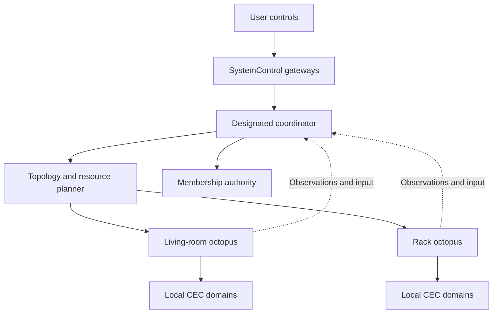
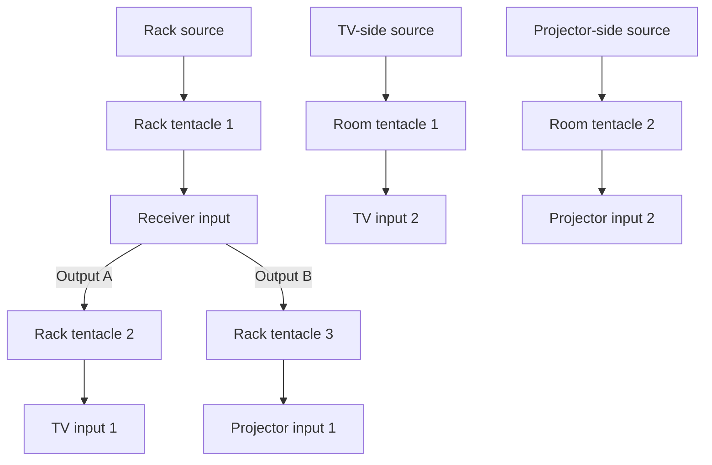

# 02 — Consortium architecture

**20 October 2026 controller-policy amendment:** [Original controller and subordinate devices](21-original-controller-policy.md) is normative. The original first-setup Amity alone hosts the UI/integrations and sole remote; added devices are UI-less actuators, never input gateways or successor controllers.

**21 October 2026 algorithm-preservation amendment:** ownership and transport layer around the original Amity algorithms; preserve existing behavior unless the user asks to change it. The emitting owner runs the original completion-paced held-key loop, with only button state changes crossing devices. [Normative rule](21-original-controller-policy.md#original-algorithms-and-functionality-amendment--21-october-2026).

**Status:** proposed v0.1. **Read with:** [octopus architecture](01-octopus-architecture.md), [domain model](03-domain-model-and-addressing.md), [transport](08-consortium-transport-and-routing.md).

## 1. Purpose and scope

A consortium is one user-managed system made of one or more octopuses. It coordinates equipment distributed across a room, rack or building while each octopus executes its local CEC work. [Issue 2](https://github.com/retsyx/amity/issues/2) motivates physically separated displays and receivers; the original controller keeps the user's sole remote while the control network reaches physically separate actuators.

Use the existing home LAN, normally Wi-Fi. A consortium is an application-level mesh of enrolled peers, with a designated coordinator in the first version. It does not establish a new Wi-Fi mesh or carry HDMI video. No cloud account, router port forwarding, central MQTT broker or always-on computer is required for local operation.

The initial validation target is eight octopuses. The supported cap is a measured build capability, advertised during enrollment and enforced before committing a member. It must account for TLS connections, heap, sockets, roster size, configuration size and all local CEC activity. The protocol must not hardcode a future permanent maximum of eight.

## 2. Logical roles

| Role | Responsibility | Initial placement |
|---|---|---|
| Coordinator | Desired state, topology, activity plans, resource arbitration, config revision and operational authority. | One designated octopus. |
| Membership authority | Enrollment approval, member identity roster and revocation. | Co-located with coordinator; logically separate interface. |
| Local actuator | Owns CEC engines, admitted proxy roles, semantic command execution and local fail-safe behavior. | Every octopus, including coordinator. |
| Input gateway | Converts the sole remote/Matter/HomeKit/web input into system intents. | Original first-setup controller only; members cannot receive input authority. |
| Integration/UI gateway | Hosts browser/admin and publishes the selected primary zone to Matter/HomeKit. | Original controller only; added devices host no UI or integration gateway. |
| Enrollment relay | Carries bounded opaque enrollment messages between a nearby candidate and authority. | An enrolled member near the candidate, when needed. |

Roles are permissions, not different firmware builds. The application must know which role authorizes a message. A valid member certificate alone does not authorize arbitrary routing, membership changes or CEC transmissions.

Only the coordinator authorizes group actuation. Every member checks current coordinator identity/epoch, its own boot/session freshness, configuration and binding generations. A standalone octopus runs the same coordinator and actuator interfaces in process. See [activity execution](07-activity-planning-and-execution.md).

## 3. Worked TV, projector and receiver system

Assume a TV and projector both connect to a receiver, with additional sources connected directly to either display. One source at the rack connects to the receiver. The cable graph could be:

The duplicate TV/projector labels denote separate inputs on the same respective component, not different displays. This diagram describes **physical HDMI paths**, not distinct CEC domains. The actual receiver/display may connect multiple CEC pins internally. The topology model must correlate those domains and allocate identities accordingly.

| Requested activity | Physical route | Important resource or limit |
|---|---|---|
| Rack source on TV | Rack source → receiver input → output A → TV input 1. | Receiver selector, output A capability, TV input selection and source proxy. |
| Rack source on projector | Same receiver input → output B → projector input 1. | Output B may need its own isolated display-side CEC control. |
| TV-side source on TV | Direct TV input 2. | No route through the receiver is implied. Receiver audio requires a separately supported return-audio path. |
| Projector-side source on projector | Direct projector input 2. | Cannot appear on TV without additional actual HDMI wiring. |
| Rack source on both displays | One receiver input fanned to both outputs. | Allowed only if the receiver supports simultaneous outputs and resource/CEC policies are compatible. |
| Different receiver sources on TV/projector | Two independent receiver input routes. | Reject unless hardware has verified independent selectors/zones. Two output sockets alone do not establish this. |

Model a receiver seen through multiple tentacles as one component with multiple observations and one owner per controlled resource. Do not create independent “TV receiver” and “projector receiver” controllers that issue conflicting input or standby commands. Component unification requires evidence or user confirmation; matching names are not sufficient.

The example does not grant ARC/eARC or TV-app support. Those need explicit audio-system role, hardware and interoperability work. Some receiver models expose CEC on only one output, which motivates a second tentacle without establishing a universal rule for receivers. [Issue 1](https://github.com/retsyx/amity/issues/1), [current project limitations](https://github.com/retsyx/amity-esp32/blob/d50af8026938797fc0820d0107f4c4e064c2d2bc/README.md).

## 4. Control and observation flows

A user selects an activity by persistent `ActivityId` and zone. The receiving gateway sends an **intent**, not raw CEC, to `SystemControl`. The coordinator resolves the actual source/display path, reserves shared resources, releases obsolete holds, stages local policy, and sends explicit operations to the octopuses that own the affected ports.

The actuators return separate outcomes: admitted, applied to the local wire, and equipment state observed. A TV acknowledging CEC does not prove a picture is visible. When confirmation is unavailable, the UI reports that limitation rather than promoting desired state to observed fact.

Members publish scoped observations with per-boot sequence numbers. The coordinator maintains immutable snapshots for UI and adapters. A noisy source must not flood the control connection with every raw frame; normalized state coalesces, diagnostic traces have their own bounded rate, and cancellation/release traffic remains serviceable.

Shared resources are planned across all active sessions. Turning the TV activity off must not put the receiver or common source in standby while the projector session still needs them. Resource conflicts produce a useful choice such as “Stop projector playback to change the receiver source.” They must not be resolved by whichever octopus sends last. See [planning and execution](07-activity-planning-and-execution.md).

## 5. Addition and setup experience

The [user-experience specification](20-user-interface.md) owns the baseline tabs, forms, device-list location context and the Amity management tab. The normal user flow is intentionally short:

1. Set up the first octopus using the profile's explicit physical setup action, the Matter-based Wi-Fi induction flow and the administration page. It creates a singleton consortium without asking the user to select a coordinator. First-board physical entry and browser trust require the implementation and product gates in documents 10 and 20.
2. In that page choose **Add Amity** (Add octopus), scan the new device's Add to Amity QR code, import its image or enter its setup code, and place the new device in its physical enrollment window. A location name is optional and can be entered while enrollment runs.
3. The coordinator automatically chooses an eligible nearby BLE helper. An authenticated protocol proves possession of the candidate's unique consortium setup secret, binds operational identities, uses available supported LAN credentials when needed, and stages membership. An already suitable candidate network is retained.
4. The candidate connects to the LAN. Both sides prove their enrolled keys over mutual TLS before membership activation. Power loss can resume the same pending join without creating two members.
5. Preserve the original activity/device form and controls. Device listings gain friendly Amity location/adapter context; the one added Amity tab manages subordinate devices. Save and Scan are non-actuating; explicit Start uses normal guarded planning.

The setup code is separate from the Matter QR/PIN, HomeKit code and administration password. The user should not need to add every octopus to a Matter home just to give it Wi-Fi. A member uses the shared network driver without a user-facing Matter server. The onboarding workflow also shares NimBLE with Matter and remotes; it is not safe to start another BLE provisioning stack. [Enrollment](09-membership-security-and-enrollment.md), [BLE coexistence](10-ble-and-matter-coexistence.md).

No Web Bluetooth dependency is required. The browser handles QR/manual input and orchestration; the enrolled octopus handles BLE. Camera access may be unavailable in some local HTTPS/browser configurations, so manual entry and code-image import should be provided. A distant candidate can use an already enrolled nearby relay; if no enrolled node can reach it, guide the user to temporarily bring it near one for initial induction.

## 6. Configuration and everyday management

Preserve the baseline tab workflows and add exactly one Amity management tab. The approved navigation order is Activities, Remote, Matter, HomeKit, Amity devices, Advanced; Advanced is last. The only change inside device listings is friendly Amity-device/HDMI-adapter location context. Keep activity name/display/source/audio/optional switch/input fields and ordinary Scan/Save/Start controls. Backend identities remain scoped; location text is not evidence of an HDMI route. [Baseline interface](20-user-interface.md).

Scanning supplies observations, not a complete authoritative HDMI wiring map. Persist device selectors as `QualifiedDeviceName`: consortium, octopus, tentacle, side and OSD name. Resolve their current logical addresses automatically, including ordinary LA changes, without asking the user to repair activities. Ask only for ambiguous connections, missing non-CEC devices, receiver output capabilities or uncertain component matches. Store these confirmations and reuse them until wiring evidence changes. Identical OSD names on distinct qualified attachments remain distinct without renaming either appliance; multiple native devices matching the same attachment/name require explicit disambiguation. Shared-domain aliases may be unified only with verified evidence. [Naming and resolution contract](03-domain-model-and-addressing.md).

Configuration revisions are staged across affected owners. Show validated, waiting-for-member, applied and degraded states. Do not claim a save was applied everywhere when a required member is offline. Component/activity label edits and route-changing edits have different activation effects. An Amity device's visible name is its actual hostname, not an independent location alias; a deliberate hostname change updates its network address while retaining the same hardware identity. Portable exports omit secrets and integration identities. [Storage and migration](11-config-storage-and-migration.md), [administration](12-control-surfaces-and-admin.md).

Current Matter/HomeKit endpoints represent one theater. Initially publish one selected **primary zone** through those existing identities, preserving sixteen stable activity selectors and alias migration. The internal planner and web interface can manage more zones. Additional Matter endpoints/HomeKit accessories are a separate compatibility feature, not automatic replication of the current single-active-state adapter.

## 7. Removal, replacement and coordinator continuity

“Offline” and “Remove” are different. An unplugged octopus retains its membership and configuration. Explicit removal first explains affected activities, then revokes the operational identity and retires the reachable node. It must not cause a still-inline removed node to resume independent standalone control. If it is offline, revocation prevents future admission, but cannot remotely erase credentials on the absent device.

Replacement uses a fresh octopus identity and fresh keys. Reassign the intended attachment after scanning and confirming cable placement, increment bindings, and preserve logical component/activity IDs where valid. Do not clone operational private keys or BLE remote bonds as part of replacement. [Lifecycle and recovery](13-faults-removal-and-recovery.md).

The original controller cannot transfer its role to an added device. During its loss, local timing, isolation and watchdog release continue while new user/group-dependent actions stop. Neither planned handover nor timeout election is supported. A stale replica, old handover record or valid member certificate cannot create a successor authority.

The original controller retains its Matter/HomeKit identity, sole remote bond and browser endpoint. Added devices never host an input bridge, UI or replacement gateway. If the main fails, the user can Matter-enroll replacement hardware and restore portable configuration through existing Advanced upload/restore. Preserve logical activity/device IDs, names/order, explicitly isolate the old main, re-pair the sole remote/home integrations and reclaim/re-enroll headless members under new trust. This is supported manual recovery, not live promotion or cloned pairing state.

## 8. Security and failure invariants

- Discovery reveals addresses and capabilities, never trust. Authenticate the exact enrolled operational key on every connection.
- A member is authorized for its declared input, observation and local execution roles. It cannot change group membership or issue commands as coordinator.
- Membership, configuration and coordinator epochs are distinct. Boot changes invalidate old execution sessions even when all durable revisions remain unchanged.
- Group work is not “exactly once.” After an uncertain relative CEC action, report unknown and reconcile observable state; do not blindly replay a toggle.
- Unplugging, partitioning, firmware mismatch or stale snapshots never enables raw CEC forwarding or autonomous conflicting power policy.
- Removing a tentacle can merge formerly isolated CEC domains. Treat recabling as a topology change and quarantine incompatible identities before enabling them.

## 9. Architecture completion criteria

Demonstrate one and two octopus systems before scaling to the qualified cap. Exercise the worked topology with shared receiver resources, a direct-TV source, a CEC-silent second output, duplicate device names and one failed member. Verify enrollment interrupted at each durable transition, held-key release during LAN loss, stale-message rejection after restart, explicit removal, actuator replacement and rejection of controller movement/promotion. Evidence must include captures at protected HDMI boundaries and fault-injected network tests, as specified in [validation](15-validation-and-release-gates.md).
