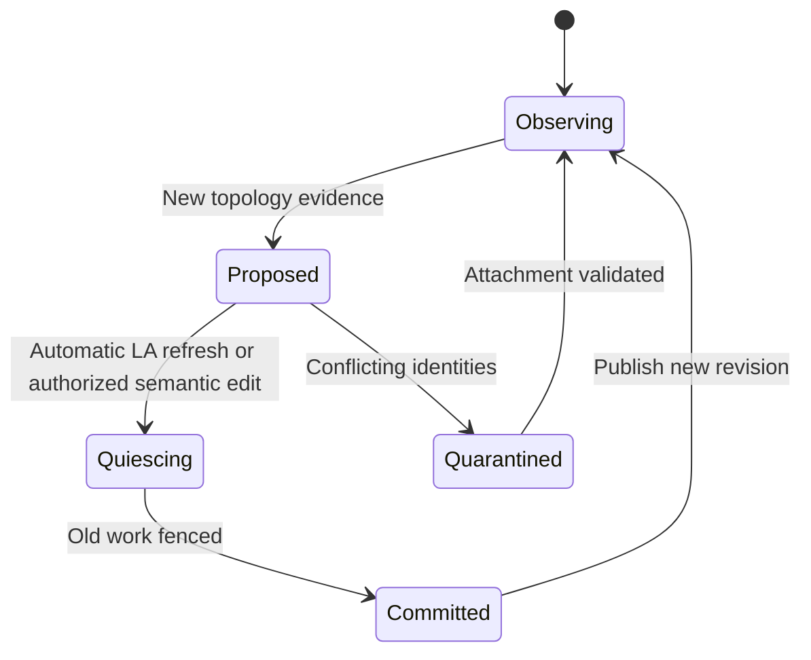

# Discovery and topology

**20 October 2026 controller-policy amendment:** [Original controller and subordinate devices](21-original-controller-policy.md) is normative. The original first-setup Amity alone hosts the UI/integrations and sole remote; added devices are UI-less actuators, never input gateways or successor controllers.

**Status: proposed implementation specification v0.1.** Discovery converts local HDMI-CEC observations and user-confirmed cable information into a versioned system graph. It must neither select an activity nor grant an observed device permission to control another CEC domain. This design uses Amity-esp32 commit `d50af8026938797fc0820d0107f4c4e064c2d2bc`, including its new dynamic front physical-address discovery.

## 1. Three different graphs

Maintain three related graphs, as defined in [the domain model](03-domain-model-and-addressing.md):

| Graph | Meaning | What it cannot establish |
| --- | --- | --- |
| Physical signal graph | Sources, display inputs, AVR inputs/outputs, and HDMI cables passing through tentacles. | Whether every CEC conductor inside an AVR is joined, switched, or absent. |
| Electrical CEC domains | Ports capable of observing the same CEC broadcast traffic. | Which video path is currently selected or whether a device supports a particular routing command. |
| Consortium membership | Authenticated Octopuses and their current reachability. | Physical cable connectivity or permission to change a route. |

An AVR may expose multiple CEC observations of one component. Several tentacles may have front ports on one AVR domain. Conversely, each source isolated by a tentacle has a separate back domain even if its HDMI video passes into that same AVR. The two sides of one tentacle are always distinct electrically; software does not bridge them.

Do not treat all AVR outputs as equivalent. For example, Denon documents no HDMI Control on MONITOR 2 for the [AVR-X3800H](https://manuals.denon.com/AVRX3800H/NA/EN/DRDZSYiewxqonr.php), and Yamaha documents a similar OUT 2 restriction for the [RX-A4A](https://manual.yamaha.com/av/20/rxa4a/en-US/3832617355.html). These are model capabilities, not a universal HDMI rule. A tentacle's front may still control the projector even when its AVR-facing back has no reachable CEC peer. Selecting the AVR output may then require a separate qualified IP/IR driver or user action.

## 2. Persistent names and runtime resolution

The persistent fully qualified device name is `QualifiedDeviceName`, containing `consortium_id`, `octopus_id`, `tentacle_id`, `side`, and **`osd_name`**. The last field is the equipment's OSD name, never its logical address. `TentacleId` remains the immutable connector index `0..4`; side is `front` or `back`. Apply the canonical name rules in [the domain model](03-domain-model-and-addressing.md); display labels and fuzzy text matches must not change selector equality.

`FullyQualifiedCecAddress` contains the same four attachment fields with `logical_address` instead of `osd_name` and is strictly a **runtime endpoint**. Discovery resolves a persistent qualified name to that endpoint. Logical address 15 is only an unregistered/broadcast context and never a resolved equipment endpoint. Frames from unregistered initiators remain port-level diagnostic events.

```cpp
struct QualifiedDeviceName {
    ConsortiumId consortium_id;
    OctopusId octopus_id;
    TentacleId tentacle_id;
    Side side;
    OsdName osd_name;
};
```

`ComponentId` is an internal stable reference to a component record, not a replacement for its persistent qualified name. That record stores `qualified_names: QualifiedDeviceName[]`: the primary native name first, then any explicitly verified native attachment aliases. A configured CEC component needs at least one such name; a non-CEC placeholder may have none. Activities may reference `ComponentId`, but resolution must follow the stored native selector rather than an old logical address.

An observation is ephemeral evidence. At minimum, retain:

```cpp
struct CecObservation {
    FullyQualifiedCecAddress endpoint; // runtime observer attachment and LA
    std::optional<OsdName> osd_name;   // actual validated OSD report, if known
    BootId owner_boot_id;
    uint64_t local_sequence;
    DomainId domain_id;
    uint64_t domain_revision;
    ObservationKind kind;
    ValidatedObservationPayload payload;
};

struct DiscoverySnapshot {
    ScanId scan_id;
    uint64_t generation;
    DomainId domain_id;
    uint64_t domain_revision;
    ScanStatus status;          // partial, complete, timeout, cancelled
    BoundedObservationSet observations;
    BoundedIssueSet issues;
};
```

Runtime timestamps are useful within the reporting Octopus and boot only. Export an observation age or receive it under the transport's TTL rules; never compare independent monotonic clock values across members. Encode all 64-bit sequences and revisions as canonical decimal strings in JSON.

### Native selectors, aliases, and proxies

A native `ComponentBinding` has `device_name: QualifiedDeviceName`, which must match a name in its component's `qualified_names` and the runtime endpoint's attachment fields. Its `BindingId` associates the capability with the current resolved endpoint, binding/domain revisions, and owner; the owner must equal the endpoint's Octopus. The runtime LA is replaceable resolution state, not part of the stored name.

A proxy binding represents a component using an identity allocated to an Amity port. It **must not contain `device_name`**. Its advertised OSD name belongs to proxy role configuration and cannot satisfy a native equipment selector, even if the text matches. Resolve native selectors against native observations; resolve proxy endpoints against the current authorized local identity allocation.

On a shared domain, several ports can observe the same device. First deduplicate consistent current native observations by domain/current LA, retaining observer aliases and evidence; only then count candidates for a scoped name. Conflicting current replies at one domain/LA indicate an unresolved identity conflict, not proven aliases. This use of LA identifies one current observation, not the same appliance across boots or address changes. A verified shared-domain alias may supply evidence for the configured attachment, but cannot silently rewrite the selector's Octopus/tentacle/side. Additional persistent native aliases must be explicitly verified.

Bare OSD names need not be globally unique. The same OSD name on two different attachments produces distinct qualified names; unifying them as one component requires verified native aliases. Two different native devices with the same name in the **same** selector scope are ambiguous: do not append an LA, pick the first reply, or prefer the remembered LA. Show the ambiguity and require a distinguishing native OSD name or attachment/selector correction. Multiple observations of one verified AVR must not manufacture that ambiguity or create several resource owners.

### Automatic logical-address refresh

For a stored qualified name, build the candidate set from fresh, validated native OSD reports on its expected attachment and current confirmed domain. Retire superseded observations and use a bounded scan when needed to resolve uncertainty; a partial scan cannot manufacture uniqueness by ignoring a still-plausible second candidate. Exactly one consistent native candidate resolves the name. No user confirmation is required when that candidate moves to another LA on the same expected attachment/domain and there is no contradictory component or topology evidence.

Commit this ordinary resolution refresh automatically through the coordinator/local policy owner. Fence work using the old binding revision, cancel stale queued operations and holds safely, account for in-flight outcomes, and increment `binding_revision` plus a domain-allocation revision if appropriate. Keep `config_revision`, the qualified name, selected activity, and session intent unchanged. Fresh commands resolve to the new LA; do not rewrite or replay queued commands, and do not require a new Select or Resume action. Discovery must emit no routing, wake, standby, or active-source operation merely because the LA changed.

Zero candidates leaves the name unresolved/stale; multiple distinct candidates make it ambiguous. An observed OSD rename is not ordinary LA churn. It requires an explicit selector update or an already-proven consistent native-component mapping that justifies and records the selector change. Retaining the old LA alone is not that proof. Selector edits, renames, and recabling are semantic configuration changes. The baseline's provisional `TV` label is not an actual OSD report and must not be persisted as though discovery proved that selector.

The existing [Hub device resolution](https://github.com/retsyx/amity-esp32/blob/d50af8026938797fc0820d0107f4c4e064c2d2bc/components/amity_hub/hub.cpp) deduplicates by OSD name and by physical address on a bus, and may call `input(current())` when the selected source resolves differently. Replace global bare-name lookup with scoped qualified-name resolution and shared-domain alias handling. Preserve automatic unambiguous resolution; remove the discovery-driven input restoration.

## 3. Establish domains before granting identities

New or unvalidated ports start with no ACK ownership. Enable monitor-all delivery using [the local runtime contract](04-hardware-and-cec-runtime.md). A grouped member's cold boot restores only passive observation and role proposals until synchronization with current authority permits probes and claims; cached policy cannot restore a stale identity claim. The standalone coordinator grants the same permissions locally. User cable declarations, passive traffic, and bounded discovery probes contribute evidence about whether ports share a domain.

Correlating identical frames seen at multiple ports is useful positive evidence. Repeated sequences associated with a serialized discovery operation strengthen it. Correlation is not infallible: unrelated devices can emit identical frames, and a source can spoof CEC contents. Silence, a timeout, or absence of a matching frame does not prove isolation. Do not invent a “harmless” vendor opcode as a guaranteed topology probe, and never use CEC observations as consortium authentication.

For ports with uncertain relationships, serialize active discovery within the whole uncertain set until domain boundaries are established. Assign a single scanner to each confirmed domain. The coordinator schedules probes and correlates authenticated reports by operation, payload, local sequence and bounded receipt windows; it does not assume synchronized clocks. A scanner may send bounded header-only presence polls and an unregistered `Give Physical Address` (`0x83`) query whose reply is broadcast. These operations do not claim an identity or grant actuation authority.

Represent domain relationships as confirmed, suspected shared, or unresolved evidence. Suspected overlap blocks contradictory role assignments. Unconfirmed attachment evidence remains unavailable. Any explicit hardware confirmation retains its provenance and is never relabeled automatically detected. The baseline activity form and Amity management tab are the only normal UI; no cable-question wizard or electrical-domain editor is added.

Only a validated domain may receive an active role assignment. Allocate logical addresses with bounded real wire polls; a wire error or arbitration loss is not a vacant address. Preserve the baseline's two unacknowledged allocation polls. The policy authority assigns the domain's one virtual TV where needed and any distinct playback proxies. A real TV already at address 0 must not cause another port to quietly invent a second TV identity at address 14. Address exhaustion is a visible configuration conflict.

## 4. Physical-address evidence and staged bootstrap

CEC physical addresses describe positions in an HDMI hierarchy; they are not device identifiers. The root is `0.0.0.0`, and downstream input positions extend that path. A source ordinarily obtains its address through the sink's EDID. The Linux kernel's [physical-address documentation](https://docs.kernel.org/userspace-api/media/cec/cec-ioc-adap-g-phys-addr.html) explains this relationship. Current Amity hardware does not expose an EDID reader to the MCU.

### Existing behavior that must be preserved accurately

The pinned [Hub implementation](https://github.com/retsyx/amity-esp32/blob/d50af8026938797fc0820d0107f4c4e064c2d2bc/components/amity_hub/hub.cpp) initializes the front PA as unknown, gathers valid nonzero `Report Physical Address` replies from the back, and chooses the numeric minimum. It rejects invalid hierarchical paths. [HubService](https://github.com/retsyx/amity-esp32/blob/d50af8026938797fc0820d0107f4c4e064c2d2bc/components/amity_hub/hub_service.cpp) scans back first, waits for replies, resolves the PA or configured fallback, then claims and announces the front playback identity. It permits the specific unregistered physical-address query even when back address allocation fails. The chosen PA remains fixed until reboot.

That heuristic works in useful original topologies: a reporting AVR at `2.0.0.0` numerically precedes its source at `2.1.0.0`. It is not an EDID measurement, and a missing AVR report can leave only a child's address. A minimum over unrelated domains has no meaning. Choosing the path with the most trailing zeroes would be another unproven heuristic, not a correction.

### Required Octopus behavior

Store PA value, reporting endpoint, applicable attachment/domain revision, provenance, and confirmation state. Distinguish an immediate-peer report, a legacy minimum hint, a user-confirmed fallback, and unknown. A syntactically valid report can still be wrong for the intended proxy; “valid” must include applicability to that attachment.

Use a staged dependency graph rather than assuming all front identities can announce at startup:

1. Begin with passive observation and the confirmed physical cable graph. Query real peers on isolated source back domains and any directly identifiable AVR domain, using restricted probes where no local identity exists.
2. Resolve a source tentacle's sink-facing proxy path from evidence applicable to that specific attachment. The source's PA report is a candidate because DDC still reaches the real downstream HDMI hierarchy.
3. Claim and announce only the resolved proxy's identity and physical address. Discovery announcement must not include `Active Source`, wake equipment, or select an input.
4. Rescan dependent domains as newly announced proxies become observable. For an AVR output tentacle, prefer evidence from its configured immediate AVR peer over a newly visible child proxy. Do not substitute a child merely because it answered first.
5. If a dependency remains unresolved, publish the missing evidence and request a confirmed fallback or an explicitly authorized measurement. Terminate the scan rather than cycling indefinitely.

An AVR serving two displays makes attachment scope especially important. Its reported PA may correspond to one selected EDID/display path. That report cannot be copied automatically onto both sink-facing proxies. Resolve the TV attachment and projector attachment separately. An explicitly authorized “select this HDMI input” measurement may observe `Routing Change` or `Set Stream Path`; it is evidence where the device emits it, not a universal discovery method. Otherwise ask the user to confirm the input/path mapping. Do not label the legacy default `1.0.0.0` confirmed merely because it exists in configuration.

A `playback_proxy` cannot claim or announce its identity until its applicable PA is resolved or its fallback explicitly confirmed. `tv_controller` uses its assigned root role; monitor-only ports do not need playback readiness. Therefore replace the old global “front allocated AND back allocated AND front PA known” readiness flag with readiness per role and per routable attachment.

## 5. Asynchronous bounded scans

The baseline waits for both buses to become quiet for 1.1 seconds, with a five-second reply-window deadline, within the Hub owner task. Scaling that loop to ten lines would let unrelated traffic delay discovery and input handling. Retain its delayed-reply correctness while moving scanning into nonblocking jobs.

```cpp
ScanTicket request_scan(const ScanRequest&);
ScanProgress advance_scan(ScanId, LocalMonotonicTime);
void cancel_scan(ScanId, CancelReason);
std::shared_ptr<const DiscoverySnapshot> scan_snapshot(ScanId) const;
NameResolution resolve_native_name(const QualifiedDeviceName&,
                                   const DiscoverySnapshot&);
BindingProposal propose_binding(const DiscoverySnapshot&);
```

`ScanRequest` includes scope, purpose, expected domain revision, and a bounded budget. A job progresses through `queued → probing → collecting → publishing → complete`; cancellation, timeout and topology invalidation are explicit terminal outcomes. Repeated compatible requests coalesce onto the existing ticket. A user request may raise a pending background job's priority; it does not create another scanner on the same domain.

Use the existing 1.1-second quiet interval and five-second maximum collection window as initial compatibility defaults, evaluated only against relevant replies and outstanding work in that domain. Add a proposed 30-second whole-job deadline covering polls, retries and collection; calibrate it in hardware tests. Busy or incomplete scans return partial/timeout snapshots. They must not extend indefinitely because a device keeps broadcasting. A multi-domain system scan aggregates bounded child jobs and reports progress without blocking the control owner.

Limit per-job observations, outstanding queries, and retry counts using the configured tested capacity. Completed snapshots are immutable. New replies create a newer snapshot or unsolicited observation; they never mutate a snapshot already given to a consumer. Keep the last accepted binding usable only while its resolution remains valid. Evidence of address reuse, a conflicting name, or ambiguity invalidates the affected execution before another command starts. “Not seen during this scan” means uncertain/stale, not automatic component or selector removal.

Matching key release and the local authority/liveness monitor outrank scans. Every scanner advancement is bounded; no polling loop, reply wait, or snapshot publication may block them. Cancellation frees probe reservations without discarding a pending release.

## 6. Recabling, revisions, and safe rebinding



A rescan may resolve ordinary LA churn automatically or propose a changed selector, PA, component attachment, domain merge, or split. These are different change classes. The coordinator uses binding fences for an unchanged-name resolution refresh; it does not ask the user to approve normal LA churn or change semantic configuration. Selector/topology changes use the explicit transition protocol in [activity execution](07-activity-planning-and-execution.md). Cancel queued work carrying stale revisions, clean up matching holds only where the old peer is still safely identified, and account for in-flight work before committing the replacement resolution. Never direct an old release to a different appliance that acquired the old LA. Discovery itself never changes an active route or announces an active source.

A merge creates a fresh `DomainId`; a split creates fresh IDs for every resulting domain. Journal those allocations before activation, retire the previous IDs with lineage, and never retain retired IDs as routable aliases. Ordinary evidence or membership updates that preserve electrical-domain identity increment its revision. Apply the deterministic rules in [the domain model](03-domain-model-and-addressing.md).

An equipment setting can change the effective EDID tree without recabling. If a qualified AVR output transition can change address evidence for the AVR or its sources, the planner must not assume its preflight bindings survive that transition. It either uses a mode verified to preserve the required addresses, or stops the remaining old plan and holds activation grants closed after changing the mode. It then collects new evidence, commits revised bindings and replans the remaining effects with a new `PlanId` and route generation before emitting anything dependent on those PAs. Discovery supplies that bounded intermediate result; it does not continue the old plan with stale physical addresses.

Recabling can join a virtual TV domain to a real TV domain, creating two address-0 identities. Unexpected traffic consistent with such a merge requires affected role quarantine and withdrawal of conflicting ACK ownership at a safe frame boundary. Software cannot guarantee immediate detection of every physical change: the current board has no MCU HPD input. The installation UI must require revalidation after cable changes, and the diagnostic view must show stale/uncertain topology honestly.

Withdrawing or replacing a domain owner requires the lifecycle rules in [faults and recovery](13-faults-removal-and-recovery.md). Loss of its network connection alone is not evidence that it has released its CEC identity. Retired nodes remain passive, and replacement nodes do not clone old physical observations without rescanning.

## 7. Work items and acceptance criteria

Implement stored qualified native names, scoped resolution, and runtime binding refresh before migrating bare-name activities. Add domain-scoped scan jobs after monitor-all runtime support. Introduce per-attachment PA provenance and staged bootstrap before enabling multi-tentacle role allocation. Show ambiguity and semantic proposals in setup; ordinary unambiguous LA churn remains automatic.

Extend the pinned [front PA host tests](https://github.com/retsyx/amity-esp32/blob/d50af8026938797fc0820d0107f4c4e064c2d2bc/tests/cec_front_physical_test.cpp) and [hardware PA fixture](https://github.com/retsyx/amity-esp32/blob/d50af8026938797fc0820d0107f4c4e064c2d2bc/tests/cec_front_physical_hardware.py). Required cases are:

- Two same-name sources on different qualified attachments remain distinct. Two distinct same-name native devices in one scope produce ambiguity; no LA is appended to either name or used as a persistent tie-breaker.
- One native source changes LA4 to LA8 on its expected attachment/domain. Its stored qualified name and `ComponentId` remain unchanged, the binding revision advances automatically, stale work is fenced, and fresh commands use LA8 without Select/Resume, user confirmation, or discovery-generated routing traffic.
- An old-generation same-name observation at LA4 does not cause permanent ambiguity after fresh bounded discovery retires it and resolves LA8. Two distinct fresh same-name candidates still remain ambiguous.
- A different appliance acquires the old LA4. Old commands and releases never reach it; matching by remembered LA cannot override the qualified native name.
- Several ports observe one confirmed AVR on a shared domain. Current domain/LA alias deduplication yields one native candidate and resource owner; a same-name Amity proxy is excluded from native resolution.
- A native OSD rename does not silently preserve identity from LA alone. An explicit or independently justified selector update is semantic; a provisional `TV` fallback label cannot masquerade as a reported OSD name.
- Initial discovery receives a delayed AVR report, a child-only report, malformed paths, no reports, and ACK-only presence. Each produces the correct provenance and readiness; a child-only heuristic never becomes an unqualified immediate-peer fact.
- Source proxies start before, after, and concurrently with AVR output proxies. No proxy announces unknown or attachment-inapplicable PA, and bootstrap terminates with a useful unresolved result when evidence is missing.
- A dual-output AVR with one CEC-capable output supports independent projector-front discovery without inventing a back peer or copying the TV PA.
- Repeated scans coalesce; unrelated busy domains cannot indefinitely delay completion. A saturated/noisy scanner cannot prevent the authority/liveness monitor or matching release.
- A stale snapshot from an old boot, domain revision, or scan generation cannot replace a newer binding. A timeout does not erase a working binding.
- A cable merge causing competing TV roles enters quarantine. No fallback address silently conceals the collision; no scan emits `Active Source`, power, or routing traffic.
- An AVR output transition that changes reported PAs invalidates the affected bindings before final activation; the old plan cannot emit a stale path while rediscovery is pending.

The discovery owner supplies fixture evidence and UI conflict examples; the hardware owner confirms electrical domain assumptions. Unresolved topology remains a visible limit on control readiness, not a reason to guess.

## Per-connector default versus detected front address

Report each front's fresh detected address separately from its selected startup address. Selection prefers that connector's current usable immediate-peer report; otherwise use only that connector's saved default as an unresolved hint. Do not use a sibling connector's report/default, a stale scan, a duplicate reporter or portable saved preferences to qualify a route. Explicit absence or failure of an installed presence detector withdraws runtime address evidence and current binding authority. Without a detector, physical presence remains unknown even when native evidence is observed. Opening/refreshing Settings reads these snapshots and never starts discovery, wake, routing or identity claims. See [preference storage](11-config-storage-and-migration.md#per-adapter-default-front-address-preferences).
