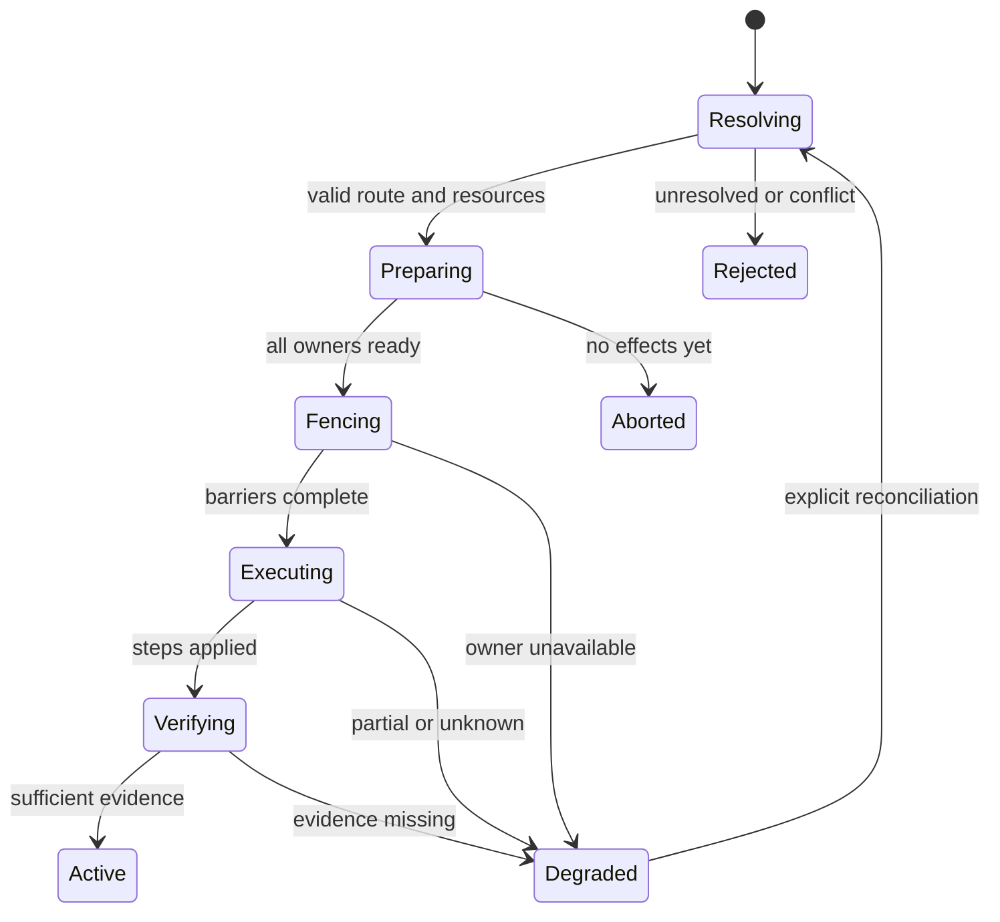

# 07 — Activity planning and execution

**20 October 2026 controller-policy amendment:** [Original controller and subordinate devices](21-original-controller-policy.md) is normative. The original first-setup Amity alone hosts the UI/integrations and sole remote; added devices are UI-less actuators, never input gateways or successor controllers.

**Status:** proposed v0.1. **Owns:** desired state, resource arbitration, operation plans and input lifetime. **Dependencies:** [model](03-domain-model-and-addressing.md), [CEC policy](06-cec-roles-and-message-policy.md), [transport](08-consortium-transport-and-routing.md).

## 1. Replace independent hub decisions with one planner

The existing hub selects one activity and powers/routes named equipment relative to the previous activity. `configure()` can call standby; new discoveries can cause input restoration. These behaviors are understandable for one two-bus controller but become unsafe when several controllers share a receiver or display. [Current activity and discovery logic](https://github.com/retsyx/amity-esp32/blob/d50af8026938797fc0820d0107f4c4e064c2d2bc/components/amity_hub/hub.cpp).

The coordinator MUST be the sole author of group desired state and resource allocations. Local agents implement explicit admitted primitives and local invariants. They MUST NOT infer an independent whole-system activity from the last CEC `Active Source`, a remote key, or a stale configuration replica.

The planner is a host-testable, deterministic module: given a committed topology, current sessions, qualified observations and an intent, return a proposed transition, a conflict, or a reason the route is unresolved. Network and GPIO operations belong to separate executors.

## 2. Public intent contract

`SystemControl` accepts requests such as:

```text
SelectActivity(actor, request_id, zone_id, activity_id, expected_state_revision?)
StopSession(actor, request_id, session_id)
AllOff(actor, request_id, scope)
KeyEvent(actor, remote_id, input_session_id, sequence, zone_id, event)
SetAudio(actor, request_id, zone_id, desired_audio_state)
Scan(actor, request_id, scope)
```

These are interface sketches, not final C++ signatures. Actor identity carries authenticated role and origin octopus. A web request is authorized before becoming a system intent; only the original controller may originate activity/key input; a member cannot obtain input-gateway permission or mutate membership. `request_id` deduplicates retries of the user's intent.

Selecting an already selected activity is a reconciliation request, not a fresh sequence of power toggles. Stopping one zone does not mean powering off the consortium. `AllOff` is explicit, scoped and still respects configured exclusions and projector/device shutdown behavior. An external integration that exposes one primary zone maps its power control to that zone's session, not to every zone.

When two users request conflicting changes, serialize requests at the coordinator and use expected state revision where the UI offers a choice. The second request sees the new state or receives a conflict. Do not apply stale confirmation text to a different running session.

## 3. Resources and compatible sessions

Represent each exclusive or conditionally shareable capability as a `ResourceId`, with owner and a compatibility function. Examples:

| Resource | Example demand | Compatibility rule |
|---|---|---|
| Receiver input selector | Input 3 | Share only if input values agree. |
| Receiver output enables | A, B or A+B | Supported combinations declared per receiver; not inferred from socket count. |
| Receiver main audio | Source X, main zone | Usually one source; second audio zone requires separate verified capability. |
| Display selector | HDMI 2 | One visible input per display. |
| Source transport | Play/seek/navigation | Multiple viewing sessions may share output, but conflicting user navigation has one explicit control owner. |
| Proxy identity | Playback LA and PA on one CEC domain | Exclusive identity allocation; compatible consumers may share the same selected route representation. |
| Component power | On | Reference-count compatible consumers; power off only after all relevant demands are released. |

The planner MUST reject an unsupported path before issuing power or routing commands. It must not display a TV-only source on a projector by substituting a similarly named source. A route contains the physical path, internal equipment selectors, proxy operations, control bindings and any required capabilities.

Resource ownership is not a generic count alone. Two sessions asking for the same receiver input can share that selector, but may disagree about output enables, audio target or CEC active-source policy. All constraints must be compatible. Sharing a source's picture does not authorize conflicting remote/browser/automation commands; the sole controller applies a visible, deterministic input-control policy.

## 4. State separates intent from equipment

Each session snapshot includes:

- Desired activity and desired source/display/audio/resource modes.
- Plan status: `idle`, `preparing`, `executing`, `verifying`, `active`, `degraded`, `failed` or `stopping`.
- Current `SessionId`, `PlanId` and `route_generation`.
- Per-step result: not sent, admitted, applied, observed, rejected, timed out or unknown.
- Observed equipment fields with age/provenance and unsupported/unknown distinctions.

`applied` means the local operation reached its defined wire-completion milestone. It does not mean that the television displays the expected image, the receiver finished switching, or the source is playing. CEC ACK and a report are different evidence. The UI may show “route commands sent; display state unconfirmed.”

V1 durably records `last_requested_sessions` for display and explicit resumption. After coordinator reboot they enter `suspended_after_restart`: synchronize and observe, but do not automatically wake, route or put equipment in standby. A fresh Select/Resume intent creates new SessionId/PlanId after validation. Restarting a required actuator degrades its affected sessions and likewise requires an explicit reconciliation intent; unaffected sessions continue. Runtime BootIds, holds, leases and command outcomes are never restored as valid merely because desired state was saved.

An ordinary same-boot reconnect may restore input eligibility for an existing session only after observing that its bindings/policy remain valid. It does not replay relative inputs or silently apply missed routing steps. If the route is uncertain, show the affected session as degraded and require a new Select/Resume intent.

## 5. Transition protocol

### Resolve and reserve

Resolve every required binding against current topology and domain revisions. Validate members, capabilities, protocol compatibility and observations. Reserve the complete resource set atomically within the coordinator's planner. Allocate `PlanId`, next route generation and operation IDs. Concurrent plans touching the same exclusive resource are ordered; disjoint compatible plans may proceed independently.

Activity component references resolve through their persisted `QualifiedDeviceName` selectors to current native bindings; proxies follow the separate representation bindings. Do not persist a resolved logical address as the selected device. An unambiguous LA change for an unchanged selector automatically refreshes resolution without modifying the activity/configuration or requiring Select/Resume solely for that change. Local discovery fences the old binding immediately; the coordinator and actuator synchronize all affected capability bindings before fresh input or replanned work can execute. Cancel old queued steps and held-key contexts rather than silently rewriting their targets. A new binding never authorizes replay of uncertain one-shot actions or discovery-triggered power/routing. Independently uncertain routes and Octopus restart recovery retain their existing explicit reconciliation rules.

### Prepare

Send a bounded preparation request to each affected owner. It contains the plan digest, required binding/domain revisions, intended policy generation and bounded operation capacity. The local agent validates and reserves capacity but does not route, power or claim unvalidated identities. A scan needed to establish a binding is a separate preflight job; it does not get hidden inside plan preparation.

If any required member rejects or times out before effects begin, release reservations and leave the existing route intact. Persist only enough coordinator intent/journal data to explain and recover the transition; do not persist a queue of relative CEC actions for blind replay.

### Fence and drain

Close admission for the old generation, including automatic routing/Active Source replies, then cancel old input holds and invalidate queued route/input work for affected resources. Closing admission must precede draining so new old-generation work cannot appear between drain and commit. Each local owner acknowledges a barrier only after an already-started frame completes or safely aborts and matching releases are handled. A new generation cannot make an old frame disappear midway through its waveform.

The policy transition must specify whether the previous route remains permitted during preparation. Conflicting routing authority transfers only after all required barriers. If a required owner is unavailable, do not grant a competing identity or conflicting shared-resource plan under a guessed timeout.

### Execute a dependency graph

Install the prepared local policy and issue semantic operations in a bounded dependency graph. Typical order is: obtain known bindings, wake required sinks/receiver, wait for qualified readiness or bounded delay, set verified receiver selector/output mode, wake the selected source through its native isolated-side binding at the tested sink/EDID readiness point, activate the chosen downstream proxy path, then allow ordinary source input. A verified always-on/source-less capability can omit source wake. Spontaneous activation caused by waking the source remains suppressed; authorized proxy actions establish the route. Independent display wake operations may run in parallel.

No universal CEC sequence is prescribed for all equipment. The plan compiler uses tested role and quirk capabilities from [document 06](06-cec-roles-and-message-policy.md). It must expose why it selected a nonstandard sequence. Protected source activation remains blocked until the local policy grants the corresponding path; a spontaneous source frame never becomes the grant.

Receiver output-mode changes can change EDID-derived physical addresses without any cable movement. A plan may continue using its prepared PAs only when that transition has qualified address stability. Otherwise treat output selection as an explicit topology-changing stage: keep activation grants closed, perform the admitted output operation, collect fresh per-attachment PA evidence, commit revised bindings, and replan remaining work with a new PlanId/route generation. Retain resource reservations while bounded discovery/revalidation runs. Timeout produces a visible degraded transition; the old plan must never emit PA-dependent routing after invalidating its own assumptions.

Each operation carries configuration, domain, binding, route generation and a receiver-issued execution lease. Validate again immediately before wire start. Sender receipt/queue acceptance is not completion. Query status by `CommandId`; do not create a new ID simply because the previous response was lost.

### Verify and retire unused demands

Collect meaningful reports and settle deadlines. Mark unknown fields explicitly. Release previous session demands once the new route reaches its defined success/degraded milestone. Power down an old display only when it is no longer needed and the transition policy requests that behavior. Keep shared receiver/source resources alive while another session consumes them.

### Fail or compensate

Before effects, abort cleanly. After effects, report partial application and reconcile observed state. Compensation is explicit and capability-aware: a known absolute input selection may be safe to restore; an unconfirmed power toggle is not. Do not power everything off to simulate transaction rollback. A projector warm-up/cooldown sequence must not be interrupted by automatic power cycling.



## 6. Worked activity transition between displays

Suppose the TV is showing receiver source X, and the user wants X on the projector instead. The planner reserves projector input, required receiver output mode and the existing source/receiver demands. It wakes the projector, establishes its separate downstream proxy path, and waits for the required readiness criterion. It does not stop source X or change the shared receiver selector simply because the display changes.

After the projector path is applied, retire the TV session if the user requested a move, release TV-only resources and optionally put the TV in standby. If the user requested simultaneous viewing, retain both display demands. A receiver with only an exclusive output choice may require a visible interruption; represent that capability rather than assuming seamless simultaneous output.

If source Y is then requested on the TV and the receiver has one input selector, the planner returns the conflicting projector session. If source Y is instead physically connected directly to the TV and no shared audio/resource conflict exists, both sessions may run independently.

## 7. Keys and remote input

The [original-algorithm preservation rule](21-original-controller-policy.md#original-algorithms-and-functionality-amendment--21-october-2026) applies to this entire document. Ownership and transport wrap the original activity/AVR/audio/switch and remote algorithms; they do not authorize replacing their normal behavior.

Normalize remote gestures locally into intents. The current input pipeline already stamps activity generation and protects releases; retain those protections while adding origin, remote, input session and destination binding. [Current input stamps](https://github.com/retsyx/amity-esp32/blob/d50af8026938797fc0820d0107f4c4e064c2d2bc/components/ble_remote/include/remote_input.hpp), [queue/generation behavior](https://github.com/retsyx/amity-esp32/blob/d50af8026938797fc0820d0107f4c4e064c2d2bc/components/amity_hub/hub_service.cpp).

Siri remote swipes MUST retain the original gesture recognition and downstream sequence algorithms: same thresholds, direction/acceleration, timing, generated presses/releases, cancellation and activity-generation behavior. Recognition remains on the original controller. Only the resulting original button transitions/taps travel to the output owner; ownership must not reinterpret a swipe or turn its finite steps into a continuing hold. Validate identical recorded input traces against the baseline with both local and remote equipment targets.

A press is bound to the zone/session/route that existed when admitted. Its hold token contains original-controller boot, local input-session ID, ordered event sequence, target binding and route generation. A release references that exact token. A late release must not stop a newer hold from another control adapter or activity. Only the original controller owns the remote; its target zone can change without adding a member gateway.

The original controller sends only button state changes: an initial down with the key, exact hold token and `repeat=true`, then an exact-token up. Repeated remote reports of the same down state do not create additional network operations. A tap uses `repeat=false` and produces one press; its completion ends its own pressed state. It produces a final release only if no other keys remain pressed for that receiving device. Volume keys resolve to the activity's configured audio component; the owning Amity performs the CEC work whether local or remote.

Preserve the baseline audio-key set (`0x41`–`0x43`, `0x65`, `0x66`) and release-driven audio query: after the physical output's CEC bus queue admits the matching release, schedule `Give Audio Status` (`0x71`) for 500 ms later, suppress it while an audio key is held, and retry after 500 ms only if query admission fails. Internal cleanup reservation and wire completion are different milestones; neither starts that timer. The explicit overflow amendment supersedes the original `release_pending` admission retry: a release may occupy slot nine when eight messages are admitted; if nine are already admitted, drop the release without retaining it for a later attempt. A dropped release does not start the audio-query timer. This observation uses the same verified endpoint and current authority; it does not authorize a new route or retargeting. CEC ACK/wire failure remains distinct from queue admission, as in the original algorithm. Scoped `Report Audio Status` (`0x7a`) projection still requires its own parity evidence; emitting a query alone does not prove volume/mute feedback.

The emitting executor preserves the original `HubService`/`Hub` completion pacing, with the user's explicit retry/failure amendments. After a successful press attempt completes, the next attempt is eligible when no command is waiting. Commands, especially button-up/cancellation, win before the next repeat. There is no timer-driven repeat cadence, accumulated repeat backlog or periodic inter-device renewal. Every `0x44` key-press frame uses one wire attempt. Any failed key transmission ends that key's pressed state and repetition; a later matching button-up is a no-op. Unchanged down reports or general authority/policy refresh MUST NOT restart the key. When no keys remain pressed for that receiving device, the executor attempts a final release, including when last-key TX failure ended the stream. The original baseline continued after admitted wire NACK/error and retried ordinary key frames; these two details are explicitly superseded by the user. The initial input/delivery deadline gates the first press and is not a lifetime limit for a successfully continuing admitted hold.

Button state and message selection belong to the executor. It validates/translates and submits directly to CEC without an ordinary, cleanup or repeat frame queue. The sole outgoing FIFO is in the CEC layer and holds eight normal messages plus one release-only overflow message per CEC wire. CEC sends exactly the supplied frames/attempt budgets and reports completion; it does not infer button state or select key/repeat/release policy from an opcode. Supplied numeric frame-start fences remain mechanical instructions from the executor. A full CEC FIFO rejects ordinary admission immediately; no executor backlog is created. Finite multi-frame recipes require atomic all-or-busy admission to that same FIFO and must not emit release while another key remains pressed for the recipient. The executor may retain exact button state, pending end-of-stream cleanup, audio-query due state and bounded correlations for already admitted work; it must not retain unsent frames as a second buffer. End-of-stream state may wait for admitted presses to finish before its release decision. Once admission of that release is attempted, consume the decision even if the nine-message limit rejects it; do not retain an unsent release or retry when capacity opens.

Each further CEC attempt still requires current acknowledged owner/plan/route authority and unchanged boot/binding context. Release, remote disconnect/lost-input cancellation, route or binding retirement, maintenance, exact authenticated link loss, or loss of current authority stops the loop and initiates matching cleanup. General authenticated link/plan liveness supplies the failure bound when a connection silently stalls; it is independent of button state and never renews or replays a gesture. The earlier per-button lease and renewal proposal is superseded.

The asynchronous multi-port runtime may poll for completion for one RTOS tick while an actual local held frame is in flight, yielding the CPU that the baseline synchronous completion wait released. Once local repetition is eligible, do not add a queue wait or repeat interval. Process pending owner commands before allowing another repeat, including multiple queued commands. A controller's remote-held bookkeeping is not local repeat work and must not create a busy loop. Measure this implementation's scheduling overhead during physical qualification; it does not authorize changing gesture timing or the original CEC continuation rule.

Exact button-up processing is retained even when ordinary semantic admission is busy. It cannot bypass bytes already in a congested TCP stream; general local authority/liveness fencing supplies the failure bound. Button-up updates only the exact key's state, stops its repeats and cancels a queued repeat that has not started. `0x45` is global for its receiving device, with no key operand: the executor submits it only when all keys for that physical wire/initiator/destination are no longer pressed and admitted presses have drained. Finite tap completion, cancellation and last-key failure also end a stream; they are not remote key-up events. Preserve the initial press of a short tap. A press canceled before its first edge alone needs no release. Pending final release must precede new positive work for that recipient. Cleanup uses a retained exact stream context separate from ended key tokens, despite the old route generation or initial input lease being retired, and cannot act on an unrelated or rebound component. Unsafe binding reuse withdraws old output permission and reports uncertainty rather than addressing a newly discovered appliance. CEC never invents release messages because of failure, timeout or queue state.

Relative volume steps, menu navigation, play/pause toggles and held-key repeats are not replayed after reconnect or reboot. If a source may have acted but the acknowledgement was lost, return `UNKNOWN_OUTCOME`. Prefer discrete power/mute commands where verified, but never relabel an inherently relative action as idempotent.

## 8. Concurrency and queue rules

The coordinator serializes mutations of desired state and resource ownership. A member serializes mutations of its local policy and port state while independent CEC engines continue concurrently. Planning, SRP, JSON, TLS and flash writes never occur in the CEC timer path.

Every queue has a measured capacity and an overload outcome. Normalized observations can coalesce by field and sequence; the latest power report replaces an older unsent power report. Plan steps and key events cannot be silently coalesced unless their operation contract explicitly permits it. Trace data is lowest priority and may drop with counters.

Outgoing CEC messages are buffered only by the CEC layer's FIFO with eight normal slots plus one release-only overflow slot per wire. Executor state/completion bookkeeping must not become an additional transmit queue. Network envelopes and ingress events have their own bounded transport contracts; they are not permission to accumulate CEC frames in the executor.

Configuration edits interact with plans through revisions. A pure component/activity-label or UI-order edit increments `presentation_revision` only and preserves active sessions, leases and holds without touching executable policy. A semantic edit increments `config_revision`, fences affected operations and requires explicit reconciliation where control behavior changes. Unchanged live owners acknowledge an idempotent revision rebase only after verifying an identical executable-policy hash and unchanged referenced bindings/roles; until then, the coordinator sends no work at their unacknowledged revision. [Document 11](11-config-storage-and-migration.md) owns that transaction. Calling the old configuration method that unconditionally puts an active system into standby violates this contract.

## 9. Work items and acceptance evidence

Implement a pure route/resource planner first, then a single-octopus executor and a fault-injected multi-octopus executor. Test at least:

- A receiver/source shared by two sessions stays on when one session stops.
- Unsupported dual-source output requests fail before any CEC effect.
- A TV-only source cannot resolve to the projector by name or coincidental PA.
- The same `request_id` creates one plan; uncertain relative operations are not replayed as new commands.
- Delayed steps from an old route, boot, binding or domain cannot start a frame.
- Policy fencing waits for already-started frames and rejects all queued stale ones.
- Queue overflow, remote disconnect and LAN loss release held keys within the qualified local bound.
- Delayed release of hold A does not release newer hold B.
- A several-second hold sends one down and one up across devices while the owner repeats locally with baseline completion pacing. No per-button renewal traffic is required, including beyond the initial delivery deadline.
- Pending commands/button-up win before a next repeat; a busy wire cannot accumulate a burst of repeats. Every key frame has one wire attempt; a failed transmission ends that key's pressed state and repetition, with later button-up a no-op and no restart on unchanged down or authority renewal. Final release occurs only at the recipient's stream end, including last-key failure; ending one of multiple active keys must not release the others.
- The executor has no outgoing frame queue. Full CEC FIFO admission reports busy immediately, atomic batches admit entirely or not at all, and final release uses slot nine or is dropped at nine without executor admission retry. CEC contains no opcode-based button/repeat/release decisions.
- Taps remain finite single presses, with implicit release at stream end; a tap must not release another active key. Equivalent local and remote audio targets preserve the original held-volume behavior.
- Siri swipe traces preserve baseline gesture recognition, timing and generated event sequences for local/remote targets, including finite-step completion, interrupted gestures, disconnect and activity changes.
- Partial execution produces accurate per-step status and safe reconciliation without blanket standby.
- Configuration rename/reorder preserves active behavior and external selectors.

The existing host tests for configuration admission, emergency release and stale generations are regression requirements, not expendable scaffolding. Extend their simulation model for independent ports, nodes and clocks before claiming distributed guarantees. See [validation](15-validation-and-release-gates.md).
