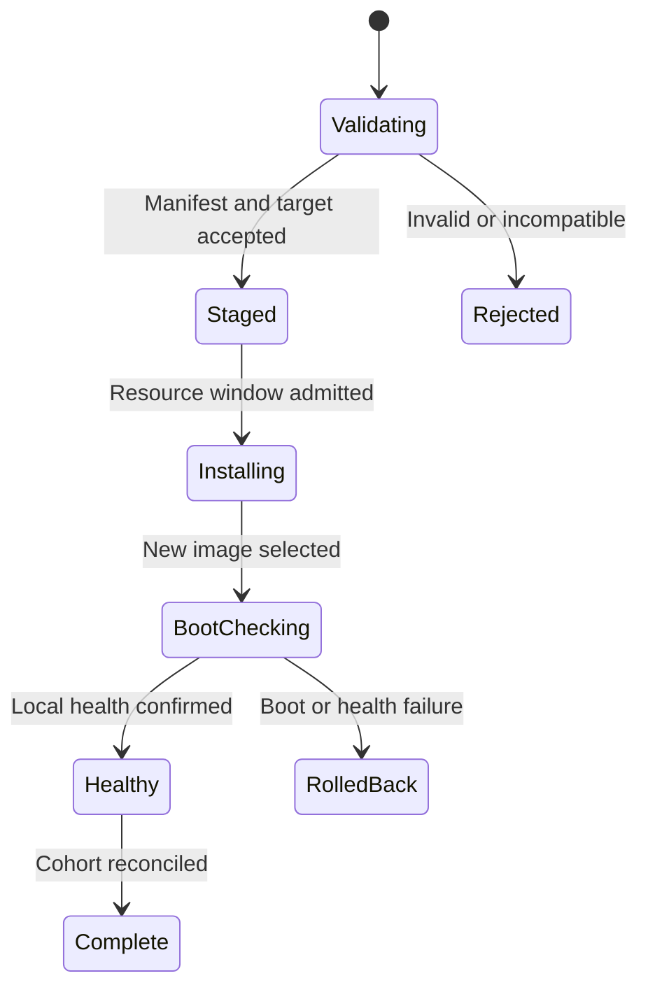

# Firmware updates and compatibility

**20 October 2026 controller-policy amendment:** [Original controller and subordinate devices](21-original-controller-policy.md) is normative. The original first-setup Amity alone hosts the UI/integrations and sole remote; added devices are UI-less actuators, never input gateways or successor controllers.

Status: proposed implementation contract v0.1. Source baseline: `d50af8026938797fc0820d0107f4c4e064c2d2bc`. This document does not authorize flashing devices, changing partition tables, or programming eFuses.

## Purpose and scope

An update must preserve CEC isolation, membership identity, recoverable configuration, and control availability where dependencies permit. This document owns release metadata, compatibility decisions, coordinated update jobs, boot confirmation, and production/development update policy. [Configuration migration](11-config-storage-and-migration.md) owns persistent schema conversion; [faults and recovery](13-faults-removal-and-recovery.md) owns replacement and authority transfer.

The baseline provides authenticated HTTPS upload to the inactive OTA slot. It checks image size, chip ID, project name and version, writes with ESP-IDF OTA APIs, selects the new boot partition, and confirms the image after application services start. It also supports explicit downgrade confirmation through `X-Amity-Confirm-Version`. These are useful mechanisms, but they do not establish a production publisher-signature or fleet compatibility policy. [Upload implementation][b-upload] [Boot confirmation][b-confirm] [Startup health point][b-startup]

## Security profiles

Keep development and production profiles explicit in build metadata, UI and release evidence.

| Profile | Required update behavior |
|---|---|
| Development | Authenticated administrator authorizes a specific image and target. Validate size, target, structure, compatibility and digest. Mark unsigned firmware clearly. Recovery/debug capability may remain enabled according to the development board profile. |
| Production | Require a verified publisher release manifest and verified firmware image, a tested secure-boot configuration, protected operational keys and encrypted persistent secrets. Reject unsigned images and unauthorized signing keys before activation. |

Development mode is not a remotely enabled escape hatch from production verification. Changing security profile is a provisioning/recovery operation, with explicit physical authorization and a new evidence record. An administration password or consortium coordinator command cannot disable the production verifier. Release-signing keys are distinct from peer TLS keys, browser certificates, setup codes and Matter/HomeKit credentials.

Mutual TLS authenticates an enrolled operational key; it does not prove the remote board booted an approved binary. Firmware version/capability reports remain authenticated reports, not hardware attestation. If a future product requires attestation, define a separate protocol and trust chain. [Membership security](09-membership-security-and-enrollment.md)

No current secure-boot or storage-protection claim should be inferred from the mere presence of `esp_secure_cert`/`nvs_keys` partitions. The baseline factory partition is a separate custom data region and the checked-in OTA path has no separate release-manifest verifier. Production protection is a release gate with measured configuration, provisioning and recovery evidence. [Partition layout][b-partitions] [Baseline defaults][b-defaults]

## Release manifest and image contract

A release consists of the application image, a bounded manifest, its signature, and human-readable release notes. The manifest contains:

- Manifest format version, release ID and firmware version.
- Exact image byte length and SHA-256 digest.
- Target chip, supported hardware-profile IDs, partition-layout ID and required slot capacity.
- Supported consortium protocol versions and required/optional capabilities.
- Readable/writable configuration, storage-record and origin/factory-record versions.
- Minimum bootloader/security-profile requirements and rollback compatibility.
- Build source commit and exact SDK/dependency identifiers.

The initial manifest encoding is UTF-8 JSON canonicalized with [RFC 8785 JCS](https://www.rfc-editor.org/rfc/rfc8785), with duplicate keys and unknown required fields rejected. Counters use the project's canonical decimal-string encoding. `signing_key_id` is the lowercase hexadecimal SHA-256 digest of the trusted key's DER SubjectPublicKeyInfo; it is included in the signed manifest. A detached P-256 ECDSA/SHA-256 signature covers those exact manifest bytes. The signature file is exactly 64 bytes: unsigned big-endian `r` followed by `s`, each 32 bytes; DER-encoded or variable-length signatures are rejected by this file format. Use a maintained cryptographic implementation with fixed cross-language test vectors, and do not implement a new signature primitive. Production firmware also uses the supported ESP-IDF/ESP32-S3 native image verification and boot verification path, configured and tested against the pinned SDK. Manifest verification cannot replace bootloader verification.

The verifier accepts only locally provisioned release-verification keys or a rotation authorized by an already trusted signing authority and the production provisioning policy. It must reject unknown key IDs, malformed signatures, a valid manifest paired with another image, and a matching digest for an incompatible target. TLS transport security is an additional protection, not the source of publisher authority.

The baseline records exact ESP-IDF, ESP-Matter, ConnectedHomeIP and HomeKit SDK commits. Retain this practice and record the complete build/dependency identity for every release. Do not equate the label “ESP-IDF 6.1” with a reproducible toolchain. [SDK baseline][b-sdks]

### One-file browser artifact

The original browser file picker accepts `amity-update.bin`. Its fixed 32-byte header contains the 16-byte ASCII magic `AMITY-UPDATE-V1\n`, a big-endian uint32 manifest length (1–8192), a big-endian uint32 signature length (0 or 64), and a big-endian uint64 native-image length (at most `0x3d0000`). Exact canonical manifest bytes, the optional raw signature, and the unchanged native image follow. Total file length must equal those bounded lengths; trailing or truncated data fails.

The target validates the exact manifest, publisher signature, hardware/security profile and compatibility before opening the inactive slot. Only native image bytes enter its existing header, SHA-256 and native OTA verification path. The browser reads the image version at the validated container offset; it never invents compatibility metadata. Raw `amity.bin` and the separate manifest/signature remain available for USB/debugging and authenticated explicitly staged uploads. The container is packaging, not an additional signing authority. `tools/update_bundle.py` packages existing release artifacts without generating keys or changing image bytes.

## Compatibility matrix

Firmware, peer protocol, configuration schema and factory format are separate axes. Peer handshakes advertise implemented capabilities; the coordinator computes a plan valid for every required owner. An octopus that cannot safely execute a required role remains quarantined/passive for that role rather than silently reverting to an older behavior.

| Compatibility condition | Decision |
|---|---|
| Protocol major unsupported | No operational actuation session. Offer compatible update or removal. |
| Optional capability absent | Disable only features whose plans require it; show the affected activities. |
| Required CEC policy/role absent | Do not enable the affected route/domain. |
| Config schema readable but not writable | May operate a validated installed slice; cannot author or migrate it. |
| Candidate writes storage unreadable by rollback image | Block activation until a compatible recovery strategy is staged and tested. |
| Hardware profile/pin/runtime unsupported | Reject the image before erasing the inactive slot where possible. |
| Membership epoch or identity mismatch | Update compatibility cannot repair authorization; follow recovery/enrollment. |

Capabilities must include behaviorally meaningful features: multi-tentacle runtime, monitor-without-foreign-ACK support, permitted role set, source-isolation policy revision, schema versions and hold-token semantics. A numeric firmware version alone is insufficient. Capability identifiers and negotiation encoding are owned by [transport](08-consortium-transport-and-routing.md).

The state-change-only held-key contract requires `owner_repeated_keys` capability 131072 for positive execution/profile synchronization. A peer supporting only the superseded per-button-renewal semantics remains accessible for compatible authenticated management/update, but cannot receive executable activity work until upgraded. The new owner repeats CEC locally using the original algorithm; wire kind/slot 4 (`hold_renew`) stays retired and the `key_press` arguments no longer contain a per-button lease. Do not activate or roll back across this semantic boundary by relying only on the older token-holds bit.

Do not raise a minimum protocol/capability barrier while required members still run incompatible firmware. First install a mutually compatible cohort, verify it, then activate the new feature/configuration revision. Rollback eligibility must be reconsidered after that barrier; an image that is byte-valid may no longer be a safe operational rollback.

## Update job state machine

A group update is a durable coordinator-owned maintenance job, identified independently from activity plans. The UI shows target nodes, impact, release identity, dependencies, progress, and per-node outcome.

Download/upload, storage validation and installation are separate stages. A UI showing “uploaded” must not imply the octopus has rebooted into the expected image. Report the expected image digest, new BootId, running version, local boot health and consortium rejoin status separately.

### Planned sequence

1. Validate the release and compatibility for the entire selected cohort. Produce an impact preview, including zones that use a targeted octopus or depend on the integration gateway/coordinator.
2. Reserve a bounded maintenance window. Cancel or finish affected holds, stop admitting new affected transitions, and preserve local source-isolation policies. Independent zones may continue only if the resource planner proves independence.
3. Stage authenticated image transfer to one owner at a time. Verify manifest, length and digest locally on the target, not only at the coordinator. Each target independently enforces its security profile.
4. Install and reboot an executor that does not currently own essential coordinator/gateway duties. The physical CEC cut remains while it is down; no bypass path is enabled for convenience.
5. Verify its new BootId, image identity, installed policy/config revision, membership and local health. Revalidate its attachments/domain roles before permitting affected plans.
6. Continue through the remaining executors. Update the original controller/UI/integration gateway last, in an explicit interruption window, without interpreting the planned outage as authorization for another node to take over.
7. Reconcile the cohort and lift any feature barrier only when required members have passed. Record incomplete, rolled-back and unavailable nodes honestly.

The order may be changed only by an explicit dependency plan. “Coordinator last” does not make downtime disappear; the original controller is immutable and added devices cannot be promoted, with or without a timeout. A coordinator update job persists enough information to resume its own report after reboot, and the UI can poll the known gateway setup/health endpoint. It does not require copying coordinator private keys or taking over another node's identity.

## Bounded transfer and radio/CEC coexistence

Use bounded chunks and backpressure. Resume only when the target has a durable record tied to the same release digest and exact byte offset; otherwise abort the partial inactive-slot image and restart. Never trust an offset supplied only by the browser. Do not expose an unrestricted peer firmware-upload endpoint to any enrolled role.

The baseline upload uses a 2 KiB buffer; retain bounded memory rather than loading an entire image into RAM. The present partition table has two `0x3d0000`-byte application slots; a larger binary requires an explicit layout/provisioning design, not a relaxed length check. [Upload buffering][b-upload] [OTA slots][b-partitions]

Flash erase/write and concurrent TLS can contend with the ten-line CEC runtime and BLE. Gate production on measured ISR timing, local release watchdog deadlines, queue capacity and reconnect behavior during updates. Keep the shared CEC timer and required code/data in the validated IRAM-safe path. An upload must be throttled or suspended if it threatens those guarantees; it must not disable local protocol checks or source filtering. [CEC runtime](04-hardware-and-cec-runtime.md) [Radio coexistence](10-ble-and-matter-coexistence.md)

The current global socket ceiling is 16; HTTPS and HomeKit each allow four open sockets, and the consortium adds persistent links. A fleet transfer must fit the approved socket/internal-RAM profile. Increasing a constant without stress and leak measurements is not an accepted fix. [Network limits][b-limits]

### HTTP request hardening port, 22 October 2026

The security fixes from main `f0efe2d` and probe correction `71baf15` retain this branch's signed release admission,
image digest and identity verification, maintenance hooks, and cohort reporting.
The HTTPS body reader now interrupts blocked TLS reads at an absolute deadline:
30 seconds for the existing metadata phase and 120 seconds for the complete local
upload. Rejected or incomplete requests close without draining the advertised
body. These limits cover management uploads; CEC input and execution algorithms
are unchanged.

HomeKit reads capped request bodies before taking its shared state mutex. Its
existing service-stop fence is checked before the read and again before dispatch,
so buffered work cannot run after ownership revocation. The ordinary HTTPS body
reader and HomeKit regressions run under ASan/UBSan; `tests/update_bundle_test.py`
executes the signed upload path with fragmented metadata and image input, deadline
and timer-creation failures, admission-before-erase checks, and retained active-slot
checks. Production signature, native secure-boot, and storage-profile requirements
remain independent release gates.

## Boot confirmation and rollback

Define two health levels:

- **Local boot health:** expected image running, storage readable, identity valid, local isolation/default policy active, CEC runtime/watchdog initialized, management/recovery service available, and no critical allocator/task failure.
- **Operational cohort health:** authorized peer connection restored, correct coordinator/configuration revisions installed, required attachments validated, and relevant activity paths available.

Confirm the boot image only after local boot health passes within a bounded window. Do not require a reachable Wi-Fi AP, attached TV, or currently online coordinator merely to avoid rollback loops. Conversely, creation of tasks alone is insufficient if the local protection policy failed to install. The group reports operational unavailability separately until reconciliation succeeds.

Rollback must load a storage format and isolation policy that the previous image understands. Keep changes readable by both images until the candidate is locally healthy; perform irreversible schema/capability activation as a later, journaled action. A crash after a non-idempotent equipment command produces an unknown outcome, not permission to replay it during rollback.

Upgrading the baseline into consortium operation needs a migration bridge: new firmware must understand the old schema and stage the new schema without making the baseline rollback image encounter unreadable active state. Confirm the new image before activating consortium-only policy/storage, then prohibit operational downgrade to a baseline image that cannot enforce membership or multi-port roles. This is a required release sequence, not a claim that a bridge release already exists.

The baseline downgrade-confirmation header remains useful for development, but production compatibility and security checks take precedence. User confirmation cannot authorize a firmware that reintroduces incompatible storage, invalid group authority, or unsigned production code. Hardware anti-rollback/security-counter advancement requires its own reviewed provisioning/recovery plan: do not advance an irreversible counter until the allowed recovery images and field process are verified.

## Identity, factory data and recovery

Normal application OTA preserves origin identity, setup verifier, membership, Wi-Fi, BLE bonds, Matter/HomeKit relationships and user configuration. It does not silently reset them to recover from a parsing error. If migration is blocked, boot into a diagnosable protected management state and retain evidence needed to recover.

Factory-v4 creation, partition-table changes, signing-root changes that require provisioning, and conversion of buttonless legacy hardware to a new physical-authorization path are explicit maintenance/provisioning workflows. Do not distribute a full fresh-install image through the application upload endpoint. The existing provisioning tool explicitly distinguishes its full image from `amity.bin` OTA updates. [Provisioning image contract][b-provision]

Power loss during inactive-slot writing must leave the running image bootable; power loss around boot selection/confirmation must recover through the tested bootloader policy. A removed/retired octopus remains retired after update. Reinstallation must not auto-form an active singleton while the board is still inline in a consortium-controlled topology.

## Work items and release acceptance

| Work item | Acceptance evidence |
|---|---|
| Manifest tool and target verifier | Valid release accepted; bad signature/digest/size/profile/layout/version combinations rejected with no activation. |
| Compatibility planner | Mixed-version cohort matrix proves which plans remain available and which are blocked. |
| Durable group update job | Coordinator/peer/browser interruption at each stage resumes or terminates without duplicate install/actuation. |
| Boot-health and schema bridge | Successful update preserves identity/pairings; failed image rolls back into a readable protected state. |
| Production provisioning profile | Recorded secure-boot/encryption settings, approved keys and demonstrated physical recovery on disposable test hardware. |
| Coexistence limits | Ten CEC lines plus Wi-Fi/BLE/TLS/OTA meet the runtime and hold-release deadlines with no unwanted egress. |

The release owner signs off exact SDK/image identities, rollback matrix, storage budget, security profile and hardware fixture evidence. Development passing does not imply production security passing. Outstanding gates remain visible in [validation](15-validation-and-release-gates.md) and [decisions](17-decisions-and-open-questions.md).

[b-upload]: https://github.com/retsyx/amity-esp32/blob/d50af8026938797fc0820d0107f4c4e064c2d2bc/components/system_services/system_services.cpp#L106-L159
[b-confirm]: https://github.com/retsyx/amity-esp32/blob/d50af8026938797fc0820d0107f4c4e064c2d2bc/components/system_services/system_services.cpp#L97-L104
[b-startup]: https://github.com/retsyx/amity-esp32/blob/d50af8026938797fc0820d0107f4c4e064c2d2bc/main/main.cpp#L244-L301
[b-partitions]: https://github.com/retsyx/amity-esp32/blob/d50af8026938797fc0820d0107f4c4e064c2d2bc/partitions.csv
[b-defaults]: https://github.com/retsyx/amity-esp32/blob/d50af8026938797fc0820d0107f4c4e064c2d2bc/sdkconfig.defaults
[b-sdks]: https://github.com/retsyx/amity-esp32/blob/d50af8026938797fc0820d0107f4c4e064c2d2bc/SDK_VERSIONS.txt
[b-limits]: https://github.com/retsyx/amity-esp32/blob/d50af8026938797fc0820d0107f4c4e064c2d2bc/sdkconfig.defaults#L181-L225
[b-provision]: https://github.com/retsyx/amity-esp32/blob/d50af8026938797fc0820d0107f4c4e064c2d2bc/amity-provision/main.go#L107-L145
