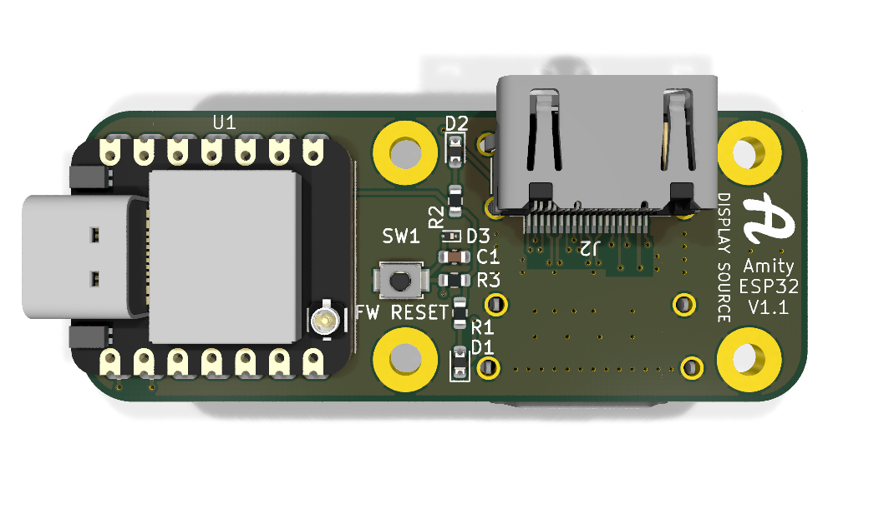
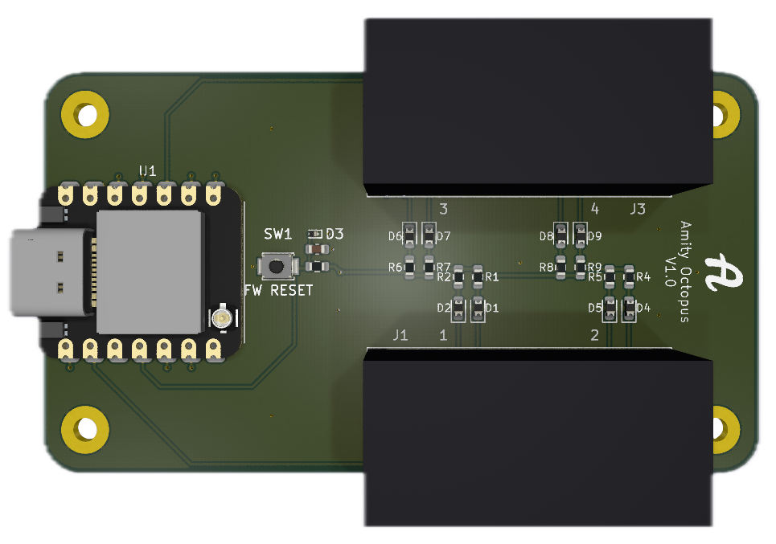
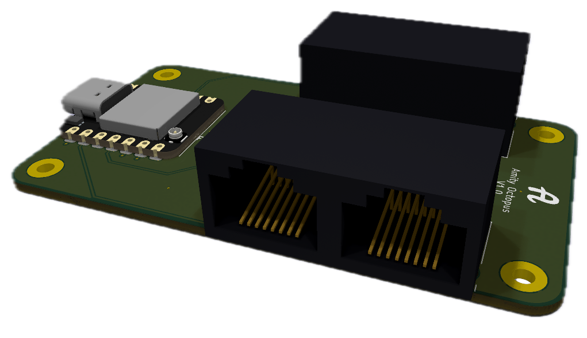
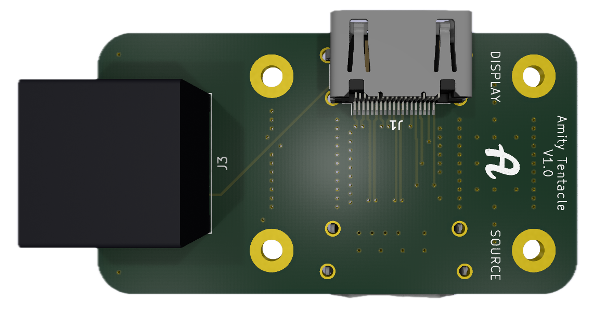
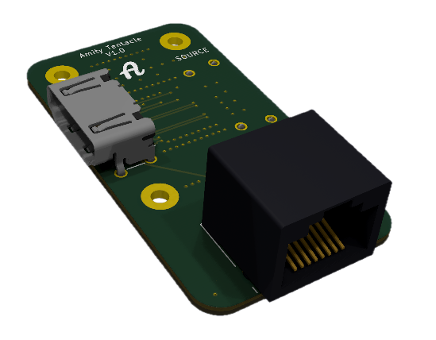

# Amity Hardware

There are a two variants of Amity hardware to choose from. Both are based on the [XIAO ESP32-S3 board](https://wiki.seeedstudio.com/xiao_esp32s3_getting_started/) because it offers a complete, inexpensive, compact solution. Other ESP32-S3 boards and even other ESP32 devices are also likely viable with the firmware's requirements of at least 512K SRAM and at least 1MB PSRAM, WiFi and BLE support. The combined memory requirement is approximately 1.2MB.

Each hardware directory has the full design along with the manufacturing outputs for PCB production and assembly.

## Single Adapter Amity ESP32

The simplest board with an ESP32 and a single HDMI adapter on a single PCB.

Design is [here](board/).

## Multi Adapter Amity

Two PCBs. One with the ESP32 and four RJ-45 connectors for the 4 adapters, and a PCB for each adapter.

The main PCB, an 'octopus', is [here](octopus/).

The adapter PCB, a 'tentacle', is [here](tentacle/).

